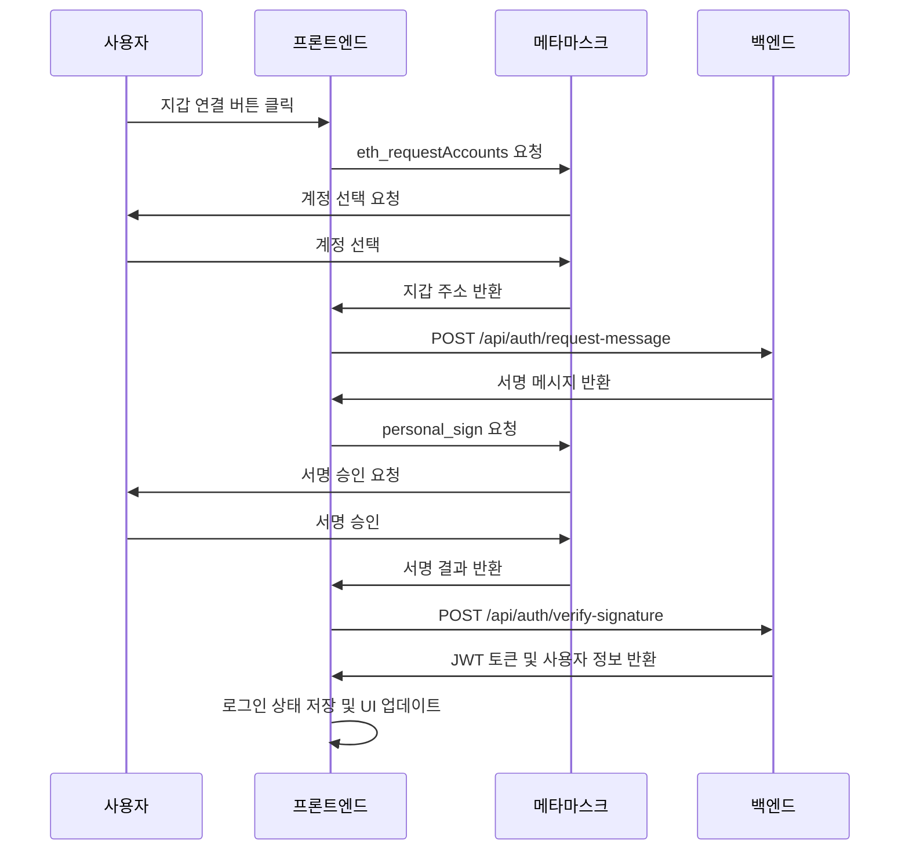

# EmotionWave 프로젝트 프론트엔드 진행상황 보고서

## 📅 작성일: 2024년 12월 19일
## 👨‍💻 담당자: 프론트엔드 개발자
## 🎵 프로젝트: EmotionWave (감정 기반 음악 플랫폼)

---

## 📋 프로젝트 개요

### 🎯 프로젝트 목표
EmotionWave는 사용자의 감정 상태를 기반으로 음악을 추천하고, 웹3 기술을 활용하여 사용자들이 직접 음악에 투자하고 응원할 수 있는 플랫폼입니다.

### 🏗️ 전체 아키텍처
```
Frontend (React) ←→ Backend API ←→ Database
     ↓
MetaMask Wallet (Web3)
     ↓
Blockchain (Ethereum/Sepolia)
```

### 🎨 주요 기능들
1. **웹3 지갑 로그인**: 메타마스크를 통한 사용자 인증
2. **음악 콘텐츠 등록**: 아티스트가 음악 업로드
3. **감정 기반 추천**: AI를 활용한 개인화된 음악 추천
4. **응원권 시스템**: 사용자가 좋아하는 음악에 투자
5. **랭킹 시스템**: 인기 음악 및 아티스트 순위
6. **마이페이지**: 개인 컬렉션 및 활동 내역

---

## 🎯 현재 진행상황

### ✅ 완료된 기능
1. **웹3 지갑 로그인 시스템 완전 구현**
   - 메타마스크 지갑 연결
   - 서명 기반 인증 플로우
   - JWT 토큰 관리
   - 로그인 상태 유지

2. **사용자 인터페이스**
   - 지갑 연결 버튼
   - 로그인된 사용자 프로필 표시
   - 응원권 개수 표시
   - 네트워크 전환 기능

3. **상태 관리**
   - 전역 인증 상태 관리 (Context API)
   - 자동 토큰 검증
   - 로그인/로그아웃 처리

### 🔄 진행 중인 기능
1. **음악 콘텐츠 관리**: 업로드, 재생, 메타데이터 관리
2. **감정 분석 UI**: 사용자 감정 입력 및 분석 결과 표시
3. **응원권 거래**: 블록체인 기반 응원권 구매/판매
4. **랭킹 시스템**: 실시간 인기 순위 표시

### ⏳ 대기 중인 기능
1. **AI 추천 엔진 연동**: 백엔드 AI 서비스와의 연동
2. **실시간 채팅**: 아티스트와 팬 간의 소통
3. **알림 시스템**: 새로운 음악, 응원권 변화 등
4. **모바일 최적화**: 반응형 디자인 완성

---

## 🛠️ 기술 스택

### Frontend
- **React 19.1.1**: 최신 React 버전 사용
- **React Router DOM 7.8.2**: SPA 라우팅
- **Material-UI 7.3.2**: UI 컴포넌트 라이브러리
- **Emotion**: CSS-in-JS 스타일링
- **Ethers.js 6.15.0**: 이더리움 블록체인 연동

### Web3 & Blockchain
- **MetaMask**: 지갑 연결 및 서명
- **Ethereum Sepolia**: 테스트넷 사용
- **Smart Contracts**: 
  - `SoulboundBadge.sol`: 소울바운드 배지 NFT
  - `RewardPool.sol`: 응원권 풀 관리
  - `ERC721Minimal.sol`: 최소 NFT 구현

### Development Tools
- **Hardhat**: 스마트 컨트랙트 개발 환경
- **TypeScript**: 타입 안정성
- **ESLint**: 코드 품질 관리
- **Vercel**: 배포 플랫폼

---

## 📁 프로젝트 구조

```
emochain/
├── public/                 # 정적 파일
│   ├── index.html
│   ├── manifest.json      # PWA 설정
│   └── favicon.ico
├── src/
│   ├── components/        # 재사용 가능한 컴포넌트
│   │   ├── WalletConnect.js    # 지갑 연결 (완료)
│   │   ├── Navigation.js       # 네비게이션 (완료)
│   │   ├── Footer.js          # 푸터
│   │   ├── RewardPoolPanel.js # 응원권 패널
│   │   └── RankingList.tsx    # 랭킹 리스트
│   ├── pages/             # 페이지 컴포넌트
│   │   ├── Home.js            # 홈페이지
│   │   ├── Upload.js          # 음악 업로드
│   │   ├── Collection.js      # 마이페이지
│   │   ├── Ranking.js         # 랭킹 페이지
│   │   ├── ContentDetail.js   # 음악 상세
│   │   └── Admin.js           # 관리자 페이지
│   ├── contexts/          # 전역 상태 관리
│   │   └── AuthContext.js     # 인증 상태 (완료)
│   ├── services/          # API 서비스
│   │   └── authService.js     # 인증 API (완료)
│   ├── eth/              # 블록체인 관련
│   │   └── contracts.js       # 스마트 컨트랙트 ABI
│   └── App.js            # 메인 앱 컴포넌트
├── contracts/            # 스마트 컨트랙트
│   ├── SoulboundBadge.sol
│   ├── RewardPool.sol
│   └── lib/ERC721Minimal.sol
├── scripts/              # 배포 스크립트
│   └── deploy.cjs
├── docs/                 # 문서
│   ├── frontend-progress-report.md
│   ├── web3-login-guide.md
│   └── api-spec.md
└── package.json
```

---

## 🔧 기술 구현 세부사항

### 1. API 서비스 레이어 (`src/services/authService.js`)
```javascript
// 주요 기능
- requestMessage(walletAddress): 서명 메시지 요청
- verifySignature(walletAddress, signature): 서명 검증 및 로그인
- logout(): 로그아웃 처리
- validateToken(): 토큰 유효성 검증
- getUserInfo(): 사용자 정보 조회
```

### 2. 인증 컨텍스트 (`src/contexts/AuthContext.js`)
```javascript
// 제공하는 기능
- 전역 인증 상태 관리
- JWT 토큰 기반 로그인 상태 유지
- 자동 토큰 검증 및 사용자 정보 관리
- loginWithWallet(), logout(), updateUser() 함수 제공
```

### 3. 지갑 연결 컴포넌트 (`src/components/WalletConnect.js`)
```javascript
// 구현된 플로우
1. 메타마스크 지갑 연결
2. 서명 메시지 요청
3. 메타마스크 서명 요청
4. 서명 검증 및 JWT 토큰 발급
5. 로그인 완료 및 UI 업데이트
```

---

## 🔄 로그인 플로우



---

## 📄 페이지별 개발 현황

### 1. 홈페이지 (`src/pages/Home.js`)
**상태**: ✅ 기본 구조 완료
- **기능**: 메인 대시보드, 추천 음악 표시
- **구현 완료**: 레이아웃, 기본 UI
- **대기 중**: AI 추천 시스템 연동, 실시간 데이터

### 2. 음악 업로드 (`src/pages/Upload.js`)
**상태**: 🔄 개발 중
- **기능**: 아티스트가 음악 파일 업로드, 메타데이터 입력
- **구현 완료**: 기본 폼 구조
- **진행 중**: 파일 업로드 처리, 블록체인 연동

### 3. 마이페이지 (`src/pages/Collection.js`)
**상태**: 🔄 개발 중
- **기능**: 개인 컬렉션, 응원권 내역, 프로필 관리
- **구현 완료**: 기본 레이아웃
- **진행 중**: 사용자 데이터 연동, 응원권 거래 내역

### 4. 랭킹 페이지 (`src/pages/Ranking.js`)
**상태**: 🔄 개발 중
- **기능**: 인기 음악/아티스트 순위, 실시간 업데이트
- **구현 완료**: 기본 리스트 구조
- **진행 중**: 실시간 데이터 연동, 필터링 기능

### 5. 음악 상세 (`src/pages/ContentDetail.js`)
**상태**: 🔄 개발 중
- **기능**: 음악 재생, 응원권 구매, 댓글 시스템
- **구현 완료**: 기본 레이아웃
- **진행 중**: 음악 플레이어, 블록체인 거래 연동

### 6. 관리자 페이지 (`src/pages/Admin.js`)
**상태**: ⏳ 대기 중
- **기능**: 플랫폼 관리, 사용자 관리, 통계 대시보드
- **구현 예정**: 관리자 권한 시스템, 데이터 분석

---

## 🎨 UI/UX 디자인 시스템

### 컬러 팔레트
- **Primary**: #667eea (보라-파랑 그라데이션)
- **Secondary**: #764ba2 (보라)
- **Accent**: #f093fb (핑크)
- **Background**: #ffffff (흰색)
- **Text**: #333333 (진한 회색)

### 컴포넌트 스타일
- **버튼**: 둥근 모서리, 그라데이션 배경
- **카드**: 그림자 효과, 호버 애니메이션
- **네비게이션**: 고정 헤더, 반응형 메뉴
- **폼**: Material-UI 기반, 유효성 검사

### 반응형 디자인
- **Desktop**: 1200px 이상
- **Tablet**: 768px - 1199px
- **Mobile**: 767px 이하
- **현재 상태**: 기본 반응형 구조 완료, 세부 최적화 진행 중

---

## 🔗 블록체인 연동 현황

### 스마트 컨트랙트
1. **SoulboundBadge.sol**: 소울바운드 배지 NFT
   - **상태**: ✅ 배포 완료
   - **기능**: 전송 불가능한 특별한 NFT 발행

2. **RewardPool.sol**: 응원권 풀 관리
   - **상태**: ✅ 배포 완료
   - **기능**: 응원권 발행, 거래, 수익 분배

3. **ERC721Minimal.sol**: 최소 NFT 구현
   - **상태**: ✅ 구현 완료
   - **기능**: 기본 NFT 기능 제공

### 프론트엔드 연동
- **지갑 연결**: ✅ 완료 (MetaMask)
- **서명 인증**: ✅ 완료
- **컨트랙트 호출**: 🔄 진행 중
- **이벤트 리스닝**: ⏳ 대기 중

---

## 📋 백엔드 API 요구사항

### 1. 서명 메시지 요청 API
```
POST /api/auth/request-message
Content-Type: application/json

Request:
{
  "walletAddress": "0x123456789abcdef123456789abcdef12345678"
}

Response:
{
  "message": "Welcome to EmotionWave! Please sign this message to confirm your identity. Nonce: 9876543210"
}
```

### 2. 서명 검증 및 로그인 API
```
POST /api/auth/verify-signature
Content-Type: application/json

Request:
{
  "walletAddress": "0x123456789abcdef123456789abcdef12345678",
  "signature": "0x1b415a953e34a2c53f7f858a7b9c9e8f47b2c21d8b7a6f9598a3b5a8e2b8c9d2d4c3f5e6a8d7a12b45c6e8f12a34b5c6d7e8f9a2b4c5d6e7f8a9b1c2d3e4f5a6"
}

Response:
{
  "status": "success",
  "token": "eyJhbGciOiJIUzI1NiIsInR5cCI6IkpXVCJ9...",
  "user": {
    "id": 1,
    "walletAddress": "0x123456789abcdef123456789abcdef12345678",
    "username": "MyDAppUser",
    "fan_ticket_count": 5
  }
}
```

### 3. 로그아웃 API
```
POST /api/auth/logout
Authorization: Bearer <JWT_TOKEN>

Response:
{
  "status": "success",
  "message": "로그아웃되었습니다."
}
```

### 4. 토큰 검증 API (선택사항)
```
GET /api/auth/validate
Authorization: Bearer <JWT_TOKEN>

Response:
{
  "valid": true,
  "user": { ... }
}
```

---

## 🗄️ 데이터베이스 설계 요구사항

### users 테이블
| 컬럼명 | 타입 | 역할 | 추가사항 |
|--------|------|------|----------|
| id | INT | PK, 사용자 내부 ID | AUTO_INCREMENT |
| wallet_address | VARCHAR(42) | 지갑 주소 | UNIQUE, NOT NULL |
| nonce | VARCHAR(255) | 서명용 고유 난수 | 로그인 후 매번 갱신 |
| username | VARCHAR(50) | 사용자명/닉네임 | |
| profile_image | VARCHAR(255) | 프로필 이미지 URL | |
| introduction | TEXT | 자기소개 | |
| social_links | JSON | 소셜 링크들 | |
| fan_ticket_count | INT | 응원권 개수 | 기본값 0 |
| created_at | TIMESTAMP | 생성일시 | |
| updated_at | TIMESTAMP | 수정일시 | |

---

## 🧪 현재 테스트 상태

### ✅ 테스트 완료
- 메타마스크 지갑 연결
- 서명 요청 및 승인
- 모의 데이터를 통한 로그인 플로우
- 로그인 상태 유지
- 로그아웃 기능

### 🔄 테스트 대기 중
- 실제 백엔드 API 연동
- JWT 토큰 검증
- 사용자 정보 CRUD
- 응원권 시스템 연동

---

## 📅 개발 일정 및 마일스톤

### Phase 1: 기반 구축 (완료)
- [x] 프로젝트 초기 설정
- [x] React 앱 구조 설계
- [x] 웹3 지갑 로그인 시스템
- [x] 기본 UI 컴포넌트

### Phase 2: 핵심 기능 개발 (진행 중)
- [x] 사용자 인증 시스템
- [ ] 음악 업로드 및 재생
- [ ] 응원권 거래 시스템
- [ ] 랭킹 및 추천 시스템

### Phase 3: 고도화 (예정)
- [ ] AI 추천 엔진 연동
- [ ] 실시간 채팅
- [ ] 모바일 최적화
- [ ] 성능 최적화

### Phase 4: 출시 준비 (예정)
- [ ] 보안 강화
- [ ] 사용자 테스트
- [ ] 배포 및 모니터링

---

## 🚀 다음 단계

### 1. 백엔드 개발 완료 후
- [ ] 실제 API 연동 테스트
- [ ] JWT 토큰 검증 로직 테스트
- [ ] 사용자 정보 업데이트 기능 구현
- [ ] 응원권 시스템 연동

### 2. 추가 기능 개발
- [ ] 사용자 프로필 편집 페이지
- [ ] 응원권 사용 내역
- [ ] 소셜 링크 관리
- [ ] 관리자 기능

### 3. 성능 최적화
- [ ] 코드 스플리팅
- [ ] 이미지 최적화
- [ ] 캐싱 전략
- [ ] SEO 최적화

---

## 🤝 팀 협업 가이드

### 프론트엔드 개발자
- **담당 영역**: React 앱, UI/UX, 웹3 연동
- **협업 필요**: 백엔드 API 스펙, 블록체인 개발자와 컨트랙트 연동

### 백엔드 개발자
- **필요한 작업**: 
  - 사용자 인증 API 구현
  - 음악 파일 관리 시스템
  - 응원권 거래 로직
  - AI 추천 시스템 연동

### 블록체인 개발자
- **필요한 작업**:
  - 스마트 컨트랙트 최적화
  - 가스비 최적화
  - 이벤트 로깅 시스템
  - 보안 감사

### 디자이너
- **필요한 작업**:
  - 모바일 UI/UX 개선
  - 브랜딩 가이드라인
  - 사용자 플로우 최적화

---

## 📁 관련 파일 목록

```
src/
├── services/
│   └── authService.js          # API 서비스 함수
├── contexts/
│   └── AuthContext.js          # 인증 상태 관리
├── components/
│   ├── WalletConnect.js        # 지갑 연결 컴포넌트
│   └── Navigation.js           # 네비게이션 (업데이트됨)
├── App.js                      # AuthProvider 추가
└── docs/
    ├── frontend-progress-report.md
    ├── web3-login-guide.md     # 구현 가이드
    └── api-spec.md            # API 스펙 문서
```

---

## 💡 기술적 고려사항

### 1. 보안
- JWT 토큰을 localStorage에 저장
- 서명 검증을 통한 지갑 소유권 확인
- Nonce를 통한 리플레이 공격 방지
- HTTPS 강제 사용

### 2. 사용자 경험
- 메타마스크 설치 안내
- 네트워크 전환 기능
- 로딩 상태 표시
- 오류 메시지 처리
- 오프라인 지원

### 3. 확장성
- Context API를 통한 전역 상태 관리
- 모듈화된 API 서비스
- 재사용 가능한 컴포넌트 구조
- 마이크로프론트엔드 준비

### 4. 성능
- 코드 스플리팅
- 지연 로딩
- 이미지 최적화
- 캐싱 전략

---

## 🐛 알려진 이슈 및 해결 방안

### 1. 메타마스크 연결 오류
- **문제**: 일부 브라우저에서 연결 실패
- **해결**: 브라우저 호환성 개선, 폴백 메커니즘 추가

### 2. 네트워크 전환 지연
- **문제**: Sepolia 네트워크 전환 시 지연
- **해결**: 사용자 안내 메시지 개선, 자동 재시도 로직

### 3. 모바일 반응형 이슈
- **문제**: 일부 모바일 기기에서 레이아웃 깨짐
- **해결**: CSS 미디어 쿼리 개선, 터치 인터페이스 최적화

---

## 📊 성능 지표

### 현재 상태
- **번들 크기**: ~2.5MB (개발 모드)
- **초기 로딩 시간**: ~3초
- **메타마스크 연결 시간**: ~2초
- **로그인 처리 시간**: ~5초

### 목표 지표
- **번들 크기**: <1MB (프로덕션)
- **초기 로딩 시간**: <2초
- **메타마스크 연결 시간**: <1초
- **로그인 처리 시간**: <3초

---

## 📞 연락처 및 문의

### 프론트엔드 개발자
- **이메일**: [개발자 이메일]
- **슬랙**: [슬랙 채널]
- **GitHub**: [GitHub 프로필]

### 긴급 문의사항
- **기술적 이슈**: 즉시 연락
- **API 연동**: 백엔드 개발자와 협의
- **블록체인 이슈**: 블록체인 개발자와 협의

---

## 🎯 결론

**현재 프론트엔드는 웹3 지갑 로그인 시스템이 완전히 구현되어 있으며, 백엔드 API만 준비되면 즉시 연동 가능한 상태입니다.**

주요 성과:
- ✅ 메타마스크 지갑 연결 완료
- ✅ JWT 토큰 기반 인증 시스템 구축
- ✅ 전역 상태 관리 시스템 구현
- ✅ 반응형 UI 기본 구조 완성

다음 단계:
- 🔄 백엔드 API 연동
- 🔄 음악 업로드/재생 기능
- 🔄 응원권 거래 시스템
- 🔄 AI 추천 시스템 연동

**팀원들의 협업과 지원을 통해 성공적인 프로젝트 완성을 기대합니다!** 🚀
